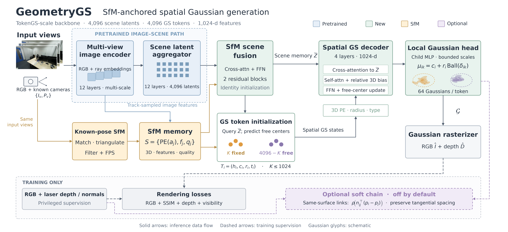

# GeometryGS 空间双层 token 架构

用户最新决定：容量直接对标 TokenGS，不主动压缩，复用图像编码器与 scene latent 聚合的预训练权重。实现为 `geometrygs.spatial_model.SpatialTokenGS`，注册名 `geometrygs_spatial`。主模型 **454,511,201 参数**，其中 **340,782,720 上游参数迁移、113,728,481 新参数**。默认全参数训练，上游 LR 为新模块的 0.1 倍；支持显式冻结上游，未自动分阶段解冻。

官方 release 总参数 362,695,680；新模型多约 25.3%，源于新增融合与更深空间 decoder，而非偷偷缩小上游。原 74,903,489 参数模型保留为 `spatial_small_sfm`，不再是默认主线。

## 架构图

[矢量 PDF](geometrygs_architecture.pdf) · [可编辑 SVG](geometrygs_architecture.svg)。
生成脚本：`scripts/draw_architecture.py`。蓝色为预训练上游，绿色为新模块，橙色为输入视角自算 SfM，紫色虚线为可选软链。底部监督路径仅训练使用；图中照片是场景示意，局部高斯为示意绘制，不是模型效果。

## 信息路径

1. RGB patch 与 Plücker 射线分别嵌入，所有视角联合编码（12 层、1024 维、16 头）。使用原 TokenGS Block，完整保留 Q/K norm、LayerScale，抽取第 5/7/9/11 层的多尺度特征及原归一化，拼接为 4096 维观察特征。
2. 输入视角独立现算已知位姿 SfM；只使用实际观察轨迹采样图像特征。记忆包含坐标 Fourier 编码、图像特征、轨迹长度、三角化角度、重投影误差。筛选/FPS 最多 1024 点。
3. 4096 个 1024 维 scene latents 经原 12 个聚合块读取多尺度图像特征，原 KV 投影/归一化一并迁移；scene latent 没有强制三维中心。之后追加 2 层 SfM 残差融合（cross-attention + FFN），两条残差的逐通道 scale 初始为零，初始输出等于原 scene 表示。没有 1024→512 压缩。
4. 4096 个 GS query 读取场景后预测自由中心；实际选中的 SfM 点替换前 K 个槽位的中心和特征。两类槽位使用共享 decoder/head 与不同类型编码。点不足时剩余槽位全部自由，不复制锚点。
5. 4 层空间 decoder。每层通过 Fourier 绝对位置、log 半径、类型增强查询；读取 scene latent；GS 自注意力使用相对位移/半径/类型的 MLP 偏置；更新特征和自由中心。锚定中心严格固定。自由中心最大更新量依次为 0.15/0.075/0.05/0.0375 归一化单位。
6. 共享局部 child MLP 每 token 生成 64 个高斯，输入和 hidden 均为 1024 维。token 投影后与 child embedding 相加，等价于拼接后线性投影的分解；按 token 分块计算以限制激活显存。

`scene_backbone.py` 只构造原图像/scene 路径，不包含原 GS decoder、latent→旧 decoder KV 投影或旧线性头。初始化严格检查所有上游 key 和 shape，缺失、多出上游层或形状不一致均报错；原 GS query/decoder/deconv 明确不加载。只保留相同维度却改变归一化/attention 计算不算有效迁移。

输入、输出均沿用 mean_cam 坐标系与 0.3 单位/米。默认成像 256×448、patch 8；SfM 用同一输入视角的 1024×1792 图像。推理不读激光、完整序列 COLMAP 或缓存几何教师。

## 空间约束

- 子中心：`mu = center + radius * delta / sqrt(1 + ||delta||²)`，真正球内约束。
- 锚定半径范围：1–8 cm；自由范围：3–50 cm，均由特征预测。这是第一版可调设置，不是经质量验证的最优值。
- 高斯每轴 scale 上限：`min(radius / 3, gaussian_scale_cap)`，下限为 0.0001 归一化单位。高斯无限支撑，不能把这一约束表述为整个高斯严格包含于球内。
- 旋转归一化为四元数；颜色、不透明度采用 sigmoid。没有强制每个 token 都为平面。
- 空间自注意力是全局可访问的，没有硬近邻截断；相对坐标除以两 token 半径和后使用带符号 log1p，连同半径比、两端类型送入小 MLP。它不是距离越近就必须相互吸引。
- 默认 query 分块 128，并使用非重入 activation checkpoint，避免保留完整 N×N×hidden 关系张量。child head 同样分块。

## 可选软链

`lambda_soft_chain=0` 时完全不执行；`spatial_sfm_chain` 默认 0.05。

只在训练中读取现有激光 depth/normal/valid 图。每个视角以 token 最高不透明度 child 提议对应像素，在该激光点 15 cm 范围内以 detached opacity 加权实际 children，构造局部代表点。无匹配则不建边。

激光 4 邻域检查平面兼容性，剔除图像边界、无效点、深度断层、法线变化大的位置。然后基于激光对应点选择最多 8 个邻居：

- 距离 <20 cm；
- 法线夹角 <10°（允许法线符号翻转）；
- 对称点到对方切平面的偏差均 <1 cm。

这些匹配、边与权重全部 detach；不训练一个可把所有链关闭的门控。惩罚实际局部代表点差在平均法线上的投影，以米计 SmoothL1（beta 2 cm）。不惩罚同平面切向间距，整片共同法向偏移仍是零空间，因此绝对几何由渲染深度等信号提供。它是训练关系损失，不是推理期额外执行的弹簧系统；推理不需要法线教师。

## 训练与评测

三个同规模主预设和一个显式小模型消融：

| 预设 | SfM | 空间编码/局部头 | 软链 |
|---|---|---|---|
| spatial_free | 关闭，所有 token 自由 | 开启 | 关闭 |
| spatial_sfm | 开启 | 开启 | 关闭 |
| spatial_sfm_chain | 开启 | 开启 | 开启 |
| spatial_small_sfm | 开启 | 开启，512 维旧实现 | 关闭 |

前三者使用相同官方上游初始化；小模型随机初始化，只能作为容量/训练方式不同的后续实验，不能把它和主模型直接比较后归因于某一个模块。

默认 100 epoch、lr 2e-4、AdamW/OneCycle、FP32；沿用 ScanNet++ 853 训练/50 验证场景设置，训练集每 epoch repeat 4。正式训练预算与硬件卡数尚未做质量调优。基础监督为 L1 RGB 0.8、SSIM 0.2、继承的可见性项 1.0、渲染 log-depth 0.1；无贴面、厚度、渲染法线或强制实心损失。

每场景随机 4–8 输入视角，另外采样 4 个不重合目标，同时监督输入 RGB。随机整模态丢弃 SfM（10%）及单点丢弃（20%）。不同场景不同输入数要求每卡 batch_size=1；增加有效 batch 使用梯度累积。多卡的空 SfM 分支仍连接所有参数图，不依赖 find_unused_parameters。

`bash EXP/run_train.sh spatial_sfm` 自动选择严格空闲卡，训练成功后复制 best checkpoint，再运行 50 场景、6 输入/8 目标的 FP32 评测和 demo。`GPUS="1 7"` 可限制允许卡号；所有对照应固定相同卡数/训练预算。主预设的初始 `resume` 指向官方 release，但只通过专门加载器严格迁移上游，初始来源 SHA 由原训练器记录；之后 workspace 自动恢复完整 GeometryGS checkpoint。手动 `--resume None` 才是同架构全随机实验。禁止旧式“只加载形状匹配张量”的静默容错。

checkpoint 内嵌 `_spatial_architecture` JSON 字节 buffer（当前 schema 2），包含构造和空间参数；评测从 checkpoint 读取，不能由路径名称猜测维度。schema 1 的旧 75M checkpoint 仍可读取。验证深度缓存单独 CPU 子进程构建，使用实际 CLI 配置，缓存键区分分辨率、视角协议、相机归一化和划分参数。

## 验证记录与限制

- `tests/`：18 passed。除原几何不变量外，增加原图像/scene 路径逐位一致、SfM 残差初始恒等、严格缺失权重拒绝、预训练路径梯度/LR 分组与重载检查。
- **当前完整主模型**：`EXP/spatial_tokengs_smoke/summary.json`，454.51M 中加载 340.78M 官方上游，8 输入、1024 锚点、4096×64 高斯、RGB/深度/软链前后向及 AdamW 更新通过；所有参数梯度存在且有限，重载输出逐位一致。单场景 step 7.03 秒、峰值 allocated 7.16 GiB（不含数据加载；不是吞吐或最坏显存保证）。日志 `EXP/spatial_tokengs_smoke.launch.log`。
- 以下为**旧 75M 版本**的工程记录，不能替代当前模型的正式训练结果：
- 真实数据小模型：通过 `geometrygs.train` 做两步更新、训练前/后各 50 场景训练内验证、best/last checkpoint 保存。workspace 为 `/mnt/disk/xveyan/workspace_scannetpp/geometrygs_spatial_smoke`。
- 完整模型：8 输入、4096×64 输出、1024 锚点；RGB/深度/软链前后向与 AdamW 更新完成，所有参数梯度存在且有限。单场景测得峰值 allocated 显存 3.80 GiB，单步 3.80 秒（不含数据加载）；不是吞吐基准或所有场景显存保证。此步建立 9904 条软链。
- 完整模型 safetensors 严格重载后输出逐位相同。结果在 `EXP/spatial_full_smoke/summary.json`，原始日志 `EXP/spatial_full_smoke.launch.log`（保留冒烟脚本 collate 修正前的失败记录）。
- 两卡 DDP、随机 4–8 输入、SfM 模态丢弃 50% 与点丢弃 20%：两步训练、50 场景训练内验证、best/last 保存通过；日志 `EXP/spatial_full_smoke/ddp.log`，workspace `/mnt/disk/xveyan/workspace_scannetpp/geometrygs_spatial_ddp_smoke`。
- 正式评测入口已用此调试 checkpoint 跑通单场景 demo：`EXP/demo/scene_7b6477cb95/spatial_smoke/`，含渲染、slot 着色、高斯、SfM 和 token 中心。

两版模型 smoke 都在验证 demo 场景上做过一步更新，仅验证工程链路，不能引用其指标证明效果或泛化。正式训练尚未启动。自由 token 是否补缺、软链是否改善厚度而保留完整度，仍须正式对照；半径设置及 SfM 过滤仍有待实验选择。
