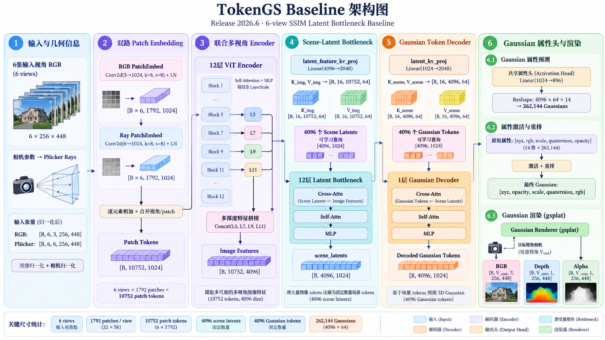
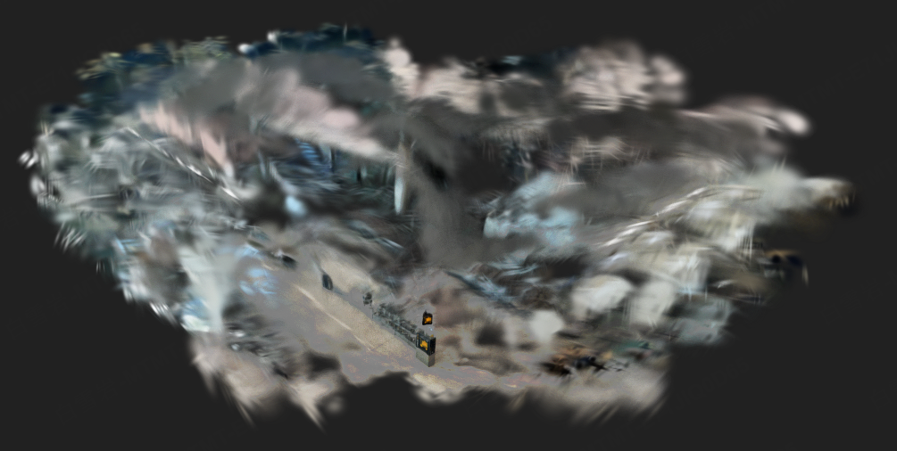
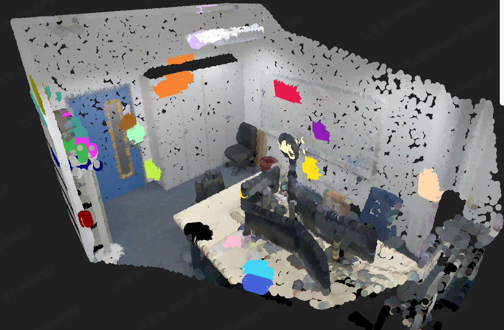
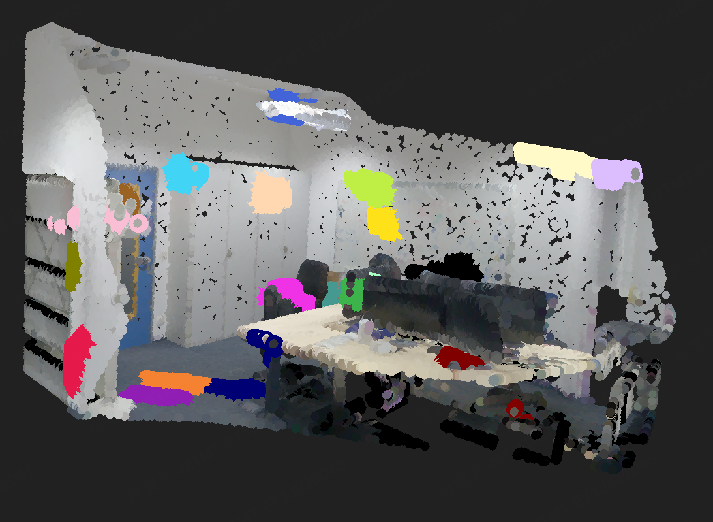
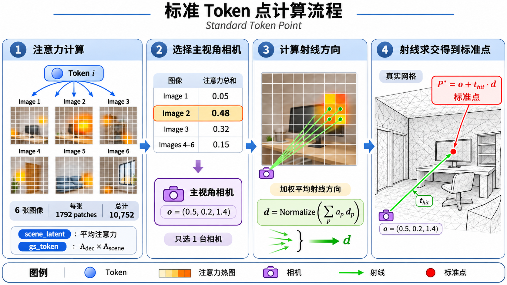
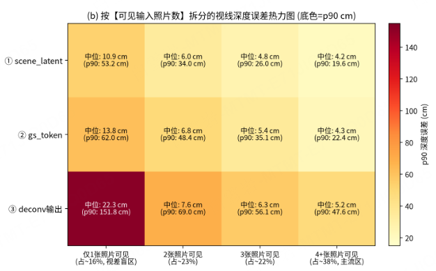
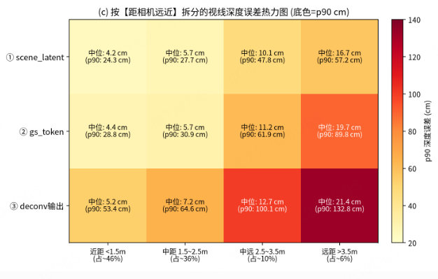
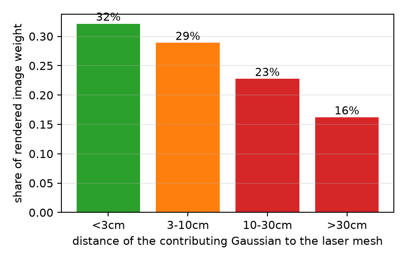
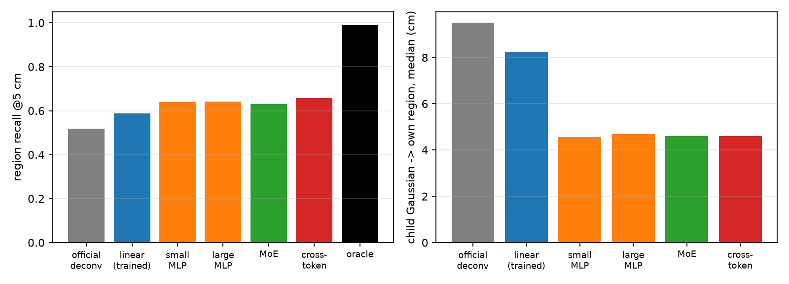
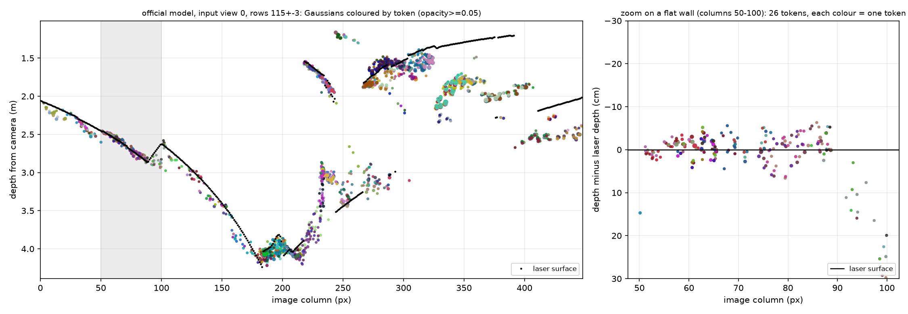

# TokenGS 分析

> 更新：2026-11-04 ｜ 数据：ScanNet++ v2，50 个室内验证场景 ｜ 评测：FP32；几何一律以激光网格为真值

*图 1　TokenGS 结构：6 张图 → 4096 个场景隐变量（scene latent）→ 4096 个高斯词元（GS token）→ 单层线性读出头（deconv）→ 262,144 个高斯。*

## 研究脉络

| 步 | 问题 | 实验 | 结论 |
|---|---|---|---|
| 1 | 基线几何怎么样？ | 50 场景评测 | 画质好，几何差 |
| 2 | 几何是没学到，还是丢了？ | 注意力可视化 + 探针 | 特征里有几何，输出时丢了长尾 |
| 3 | 加激光监督能补回来吗？ | 逐项加损失的后训练 | 深度能补；压薄会掉画质；加结构无效 |
| 4 | 为什么加结构无效？ | 检查训练过程 | 读出头几乎没被训练，之前的结论不成立 |
| 5 | 先验证假设，再设计实验 | 4 个不训练或只训小网络的检验 | 读出头需要非线性和三维监督；厚雾不是词元的必然结果，主要来自不同词元在不同深度叠放 |
| 6 | 按验证结果重新训练 | 三维贴面监督 + 放开场景隐变量尾段 | 几何与画质首次同时提升；上游监督是关键 |
| 7 | 如何从结构上解决叠放？ | 架构设计（进行中） | 加一个所有词元共享、由激光直接监督的表面层 |

---|---|---|---|
| 1 | 基线几何怎么样？ | 50 场景评测 | 画质好，几何差 |
| 2 | 几何是没学到，还是丢了？ | 注意力可视化 + 探针 | 特征里有几何，输出时丢了长尾 |
| 3 | 加激光监督能补回来吗？ | 逐项加损失的后训练 | 深度能补；压薄会掉画质；加结构无效 |
| 5 | 为什么加结构无效？ | 检查训练过程 | 读出头几乎没被训练，之前的结论不成立 |
| 6 | 先验证假设，再设计实验 | 6 个不训练或只训小网络的检验 | 读出头有上限；压薄的代价来自表示本身；缺信息的地方视差太小；厚雾主要来自不同词元在不同深度叠放 |
| 7 | 按验证结果重新训练 | 三维贴面监督 + 放开场景隐变量尾段 | 几何与画质首次同时提升；上游监督是关键 |
| 8 | 如何从结构上解决叠放？ | 架构设计（进行中） | 加一个所有词元共享、由激光直接监督的表面层 |

---

## 1 发现问题：画面好看，几何不对

TokenGS 只用照片训练，监督信号只有渲染画面。模型可以靠颜色、透明度、尺度和遮挡来降低画面误差，却不必把高斯放在真实表面上。

**实验**：官方模型直接前馈，在 50 个验证场景上同时评测画质和几何。

**结果**：

| 画质 | 数值 | 几何 | 数值 |
|---|---:|---|---:|
| PSNR | 30.50 | 深度相对误差 AbsRel | 0.174 |
| SSIM | 0.927 | 深度 RMSE | 33.9 cm |
| | | 视线厚度 中位 / p90 | 8.6 / 25.7 cm |
| | | 表面精度 Accuracy | 22.4 cm |

*图 2　基线输出的高斯，表面被一层厚雾包裹。视频：[video_baseline_camera_path.mp4](video_baseline_camera_path.mp4)。*

发现三个问题（第 1 点的细针数字和第 3 点来自单个场景 7b6477cb95）：

1. **沿视线成雾、成针**：一条视线上的高斯深度散开中位 8.6 cm，最厚 10% 达 25.7 cm；高斯常被拉成沿视线的细针（按不透明度加权，长短轴比中位 26.7，长轴与视线夹角余弦中位 0.80）。
2. **弱纹理区域位置错误**：显示器等区域只贴合了颜色，位置不对。
3. **大量废点**：68% 的高斯几乎透明（α < 0.05），16% 落在房间之外；26 万个高斯里接近实心（α ≥ 0.9）的只有 10 个。

**引出的问题**：几何是模型根本没学到，还是学到了却在输出时丢了？

---

## 2 几何丢在哪里

这三个问题可能出在三处：场景隐变量、高斯词元、读出头。所以逐层检查。

### 2.1 词元是否理解空间：可视化

**实验**：取第 7 层注意力（场景隐变量），或"解码器注意力 × 第 7 层注意力"（高斯词元），按相机位姿投到激光点云上，随机看 20 个词元。

 

*图 3　20 个词元的注意力在激光点云上的位置（左：场景隐变量，右：高斯词元），一种颜色是一个词元。*

**结果**：

- 每个词元只看一小块表面：约 17 个图像块，约 8 cm 大小。
- 同一个词元在不同照片里看的是同一块表面。
- 约 9–17% 的词元横跨深度跳变（如桌沿与后面的墙）。

**证明了**：词元有空间分工，并且在做**跨视角匹配**。

### 2.2 词元理解到什么程度：探针

**实验**：在冻结的模型旁训练一个探针网络（6 层 Transformer），只看特征，预测每个词元所看表面的位置。853 个训练场景训练，50 个验证场景测试。真值是"标准点"：从主视角相机沿注意力方向发出射线，与激光网格的第一个交点（图 4）。

*图 4　标准点计算流程。*

**结果**：

| 误差（cm，中位 / p90） | 场景隐变量 | 高斯词元 | 模型实际输出* |
|---|---:|---:|---:|
| 方向（横向） | 0.2 / 0.7 | 0.2 / 0.7 | 0.2 / 0.7 |
| 深度（沿视线） | **5.5 / 31.3** | **5.8 / 38.4** | **7.1 / 68.2** |
| 到所负责表面的最近距离 | 3.2 / 15.5 | 3.3 / 17.1 | 3.9 / 40.0 |

\* 模型实际输出不是探针，而是该词元 64 个高斯按不透明度加权的中心。

 

*图 5　深度误差按"被几张输入照片看到"（左）和"离相机多远"（右）分组。*

- 方向都对，误差几乎全在深度。
- 从场景隐变量到高斯词元，几乎没有损失；到了输出，长尾翻倍（p90 从 38 cm 增至 68 cm）。
- 线性探针只能读到 17.0 / 73.4 cm：信息存在，但不是线性可读的。
- 长尾集中在只被 1 张照片看到（p90 从 62 cm 增至 152 cm）和距离远的区域。

**证明了**：几何信息在特征里（大多数区域约 6 cm 精度），主要丢在最后的线性读出头。

---

## 3 加激光监督，能补回多少

**思路**：既然信息在、读出丢了，那就只训练读出链路（高斯词元 + 解码器 + 读出头），场景隐变量冻结，每步只加一样东西。全部 10 个 epoch，从官方权重开始。

| 实验 | 插值 PSNR | AbsRel | 厚度 p90 (cm) | Accuracy (cm) | F@5cm | 法线误差 |
|---|---:|---:|---:|---:|---:|---:|
| 基线 | 30.50 | 0.174 | 25.7 | 22.4 | 0.445 | 37.3° |
| ① `sft_latenttail_rgb`（放开场景隐变量尾段，只用画质损失） | **31.19** | 0.165 | 23.2 | 20.6 | 0.445 | 36.6° |
| ② `sft_readout_rgb`（读出链路，只用画质损失） | 30.97 | 0.174 | 24.8 | 22.4 | 0.444 | 37.3° |
| ③ `sft_readout_rgb_depth`（+ 深度损失） | 30.50 | **0.103** | 28.0 | **11.3** | **0.557** | 32.6° |
| ④ `…_depth_thick`（+ 厚度损失） | 29.85 | 0.110 | **7.1** | 11.7 | 0.500 | **29.9°** |
| ⑤ `…_thick_sh1`（+ 球谐颜色） | 29.85 | 0.112 | 7.2 | 11.9 | 0.496 | 30.1° |
| ⑥ `…_thick_posmlp`（+ 非线性位置头） | 29.79 | 0.111 | 7.2 | 11.8 | 0.496 | 29.9° |
| ⑦ `…_posmlp_surfel_binar`（+ 面元约束 + 不透明度二极化） | 29.17 | 0.110 | 8.0 | 11.8 | 0.477 | 29.5° |

① 训练 30 个 epoch，其余 10 个。

逐步看：

1. **只用画质损失（①②）**：画质提高，几何不变。→ 证明：**不加几何监督，几何不会自己变好**。
2. **加深度损失（③）**：深度误差降 41%，Accuracy 减半，画质与基线持平；但视线厚度没有变好。→ 证明：深度监督能把表面拉到正确深度，**雾还在**。
3. **再加厚度损失（④）**：厚度 p90 从 28 cm 降到 7 cm，法线更准，但插值 PSNR 低 0.65 dB。→ 出现**画质与几何的冲突**。
4. **试图挽回画质（⑤⑥⑦）**：球谐颜色、非线性位置头、面元约束都无效，⑦ 更差。

**新问题**：为什么球谐颜色、非线性位置头、面元约束这些结构都没有效果？

---

## 4 反思：为什么加结构无效

**检查**：训练后读出头的权重相对原模型变了多少？⑥ 的非线性位置头实际把高斯挪了多远？

**结果**：

- ②③④ 的读出头权重只变了 0.08% / 0.12% / 0.21%（学习率 ×0.1，共约 2,000 次更新）。
- ⑥ 的位置头只把高斯挪动约 1 cm，而要修的长尾误差是 30–70 cm。
- 训练时目标视角全部在窗口内，从未要求新视角正确。
- 厚度损失只在已经画实的像素上计算，第 1 个 epoch 就降到接近 0，模型找到了捷径。

**证明了**：读出头几乎没有被训练到，"加结构无效"不能说明结构没用。

**决定**：先把关键假设逐个验证清楚，再设计下一个训练实验。

---

## 5 验证假设

### 5.1 词元是否画在它看的地方？

**为什么要问**：第 2 步的探针默认"词元看哪里，就负责画哪里"。如果不成立，探针结论就要打折扣。

**实验**：在输入视角下精确计算每个词元的高斯给哪些像素贡献了颜色，和它的注意力区域对比（不训练）。

**结果**：词元的渲染贡献 87% 落在它的注意力区域内，两区域中心相距 2.5 cm。

*图 6　输入视角的渲染画面中，颜色来自离激光表面多远的高斯。*

顺带发现：约 **39%** 的画面由离真实表面 10 cm 以上的高斯画出，而特征里的深度精度约 6 cm。

**证明了**：词元负责画的就是它看的地方，探针的结论成立；输出确实没用好特征里的信息。

### 5.2 换一个读出头，能读出多少？

**为什么要问**：探针只预测 1 个点，而读出头要摆 64 个高斯，并且要贴面、盖满。这不是同一件事。

**实验**：特征冻结，只训练读出头，用激光点直接监督每个词元的 64 个高斯，比较不同结构。

*图 7　左：负责的表面在 5 cm 内被高斯盖住的比例；右：高斯离负责表面的中位距离。上限是直接从真值里挑 64 个点。*

| 读出头 | 覆盖率 @5cm | 高斯离面距离 中位 / p90 |
|---|---:|---:|
| 官方线性读出头（不训练） | 0.52 | 9.5 / 403 cm |
| 线性（训练；3 种学习率都停在约 0.59） | 0.59 | 8.2 / 67 cm |
| 小 MLP | 0.64 | 4.6 / 29 cm |
| 大 MLP / 专家网络 | 0.64 / 0.63 | 4.7 / 29 cm、4.6 / 30 cm |
| 可跨词元交换信息 | 0.66 | 4.6 / 23 cm |
| 上限（64 个真值点） | 0.99 | 0 |

**结果**：

- 线性结构有上限，换学习率无效。
- 加一个小的非线性头，离面距离减半。再加大、加专家都无效。
- 离上限仍差很多，而且训练集上同样达不到（大 MLP：训练 0.649，验证 0.642）。
- 对照第 4 步：同样的非线性位置头，用渲染监督只挪动约 1 cm，用直接三维监督离面距离减半。

**证明了**：

1. 读出头确实是瓶颈之一，需要非线性。
2. 只靠渲染监督教不会它，需要**直接的三维监督**。
3. 剩余差距来自特征里本来就没有的信息。

### 5.3 厚雾是否是"词元"这种表示的必然结果？

**猜测**：一个词元的 64 个高斯天然聚成一团椭球，而不是贴着表面的圆片，所以成雾。

**实验**：每个词元的 64 个高斯中心按不透明度加权求三个主轴，与它负责的激光表面对比（不训练）。

| 中位数（不含跨深度跳变的词元） | 真实表面 | 官方模型 | + 深度损失 | + 深度 + 厚度损失 |
|---|---:|---:|---:|---:|
| 扁平度（0 = 圆片，1 = 球） | 0.24 | 0.58 | 0.56 | 0.53 |
| 最薄方向的厚度 | 0.9 cm | 1.9 cm | 2.2 cm | 1.4 cm |
| 最薄方向与表面法线的对齐（随机 = 0.5） | — | 0.64 | 0.50 | **0.84** |
| 沿视线 ÷ 横向的散开 | 1.32 | 1.37 | **2.05** | 1.03 |

**证明了**：

1. 官方词元比真实表面更"团"，但整体很小（最长约 7 cm、最薄约 2 cm），解释不了 25.7 cm 的厚度 p90。
2. 同样的结构，加厚度损失后就能变成与表面对齐的圆片，所以厚雾**不是词元表示的必然结果**。
3. 只加深度损失，词元会沿视线拉长，这解释了深度模型的厚度为什么反而变差。

### 5.4 厚雾到底从哪来？

**实验**：把每条视线的厚度精确拆成两部分："同一词元内部"的散开，和"不同词元之间"的错开。同时比较训练见过的输入视角上的画质（不训练）。

| 模型 | 视线厚度 中位 / p90 | 来自不同词元之间 | 输入视角 PSNR | 目标视角 PSNR |
|---|---:|---:|---:|---:|
| 官方模型 | 7.8 / 25.8 cm | **90%** | 32.35 | 30.50 |
| + 深度损失 | 11.4 / 29.9 cm | 64% | 32.17 | 30.50 |
| + 深度 + 厚度损失 | 2.8 / 7.1 cm | 82% | 31.21 | 29.85 |

*图 8　官方模型在 Demo 场景的一张输入视角中，取一条 6 像素高的水平带，画出落在其中的高斯（α ≥ 0.05）：横轴是图像列，纵轴是深度；每种颜色代表一个词元，黑点是激光表面。左：整条带；右：灰色区域（一面平整墙）的放大图，纵轴改为"与激光深度之差"。*

- 右图这一段 50 像素宽的平整墙面，由 **26 个词元**共同负责。它们的高斯前后交错，分布在真实表面前后约 ±6 cm 的范围内，没有一个词元独占某一层。这就是"不同词元之间深度不一致"形成的雾。
- 而且这还是在输入视角、平整墙面这种**最容易的情况**下。左图第 220–420 列，有成片的高斯落在离真实表面 0.3–0.8 m 的地方。

**证明了**：

1. **厚雾主要来自多个词元在同一条视线上把高斯放在不同深度**。单个高斯沿视线的长度只有约 2 cm。
2. 按像素厚度分档看（官方模型）：

   | 视线厚度 | 像素占比 | 来自不同词元之间（逐像素中位） |
   |---|---:|---:|
   | < 3 cm | 9% | 51% |
   | 3–10 cm | 52% | 64% |
   | 10–30 cm | 31% | 84% |
   | > 30 cm | 8% | 97% |

   雾越厚，越是由词元之间的错开造成；典型像素约 2/3 来自词元之间，其余是同一词元内部的散开。按全部像素合并算是 90%，逐像素取中位是 72%。
3. 压薄后，连训练见过的输入视角都掉了约 1 dB。所以厚度损失的代价是**拟合能力下降**，而不是换视角后不一致。

---

## 6 第二轮训练：三维贴面监督

**思路**：前面的检验说明，渲染监督教不会读出头；雾来自词元之间的叠放；缺信息的地方需要上游学习。所以直接用激光监督每个词元的 64 个高斯：它们要**贴在**自己负责的那块激光表面上，并把它**盖满**。区域的定义与 5.2 节相同。

| 实验 | 插值 PSNR | AbsRel | 厚度 p90 (cm) | Accuracy (cm) | Completeness (cm) | F@5cm | 法线误差 |
|---|---:|---:|---:|---:|---:|---:|---:|
| 基线 | 30.50 | 0.174 | 25.7 | 22.4 | 10.2 | 0.445 | 37.3° |
| ③ + 深度（对照） | 30.50 | 0.103 | 28.0 | 11.3 | 8.2 | 0.557 | 32.6° |
| ⑧ + 三维贴面 | 30.01 | 0.102 | 23.3 | 10.6 | 8.7 | 0.551 | 32.8° |
| ⑨ + 小 MLP 位置头 | 30.21 | 0.099 | 22.4 | 10.5 | 8.7 | 0.552 | 30.5° |
| ⑩ ⑨ + 放开场景隐变量尾段 | **30.63** | **0.071** | **13.9** | **7.4** | **7.8** | **0.626** | **22.2°** |
| ⑪ ⑨ 训练 20 个 epoch | 30.30 | 0.090 | 20.0 | 9.5 | 8.4 | 0.565 | 28.4° |
| **⑫ ⑩ 训练 20 个 epoch** | **30.69** | **0.066** | **13.6** | **6.9** | **7.4** | **0.641** | **21.0°** |

（⑧ `sft_readout_rgb_depth_surface3d`，⑨ `…_surface3d_posmlp`，⑩ `sft_latenttail_readout_rgb_depth_surface3d_posmlp`，⑪ `…_surface3d_posmlp_ep20`，⑫ `sft_latenttail_readout_…_posmlp_ep20`）

各模型的厚度拆分：

| 模型 | 视线厚度 中位 / p90 | 来自不同词元之间 | 输入视角 PSNR |
|---|---:|---:|---:|
| ⑧ | 9.5 / 25.0 cm | 66% | 31.42 |
| ⑨ | 8.8 / 24.2 cm | 65% | 31.69 |
| ⑩ | **4.9 / 15.0 cm** | 71% | **32.23** |

**结果**：

1. **只在读出链路上加三维贴面（⑧⑨），几何只是小幅改善，画质还下降了**。原来甩到远处、靠透明度"隐身"的高斯，被这个损失拉回了表面。
2. **放开场景隐变量尾段（⑩），几何和画质首次同时提升**：相对 ③，深度误差再降 31%，厚度 p90 减半，法线误差从 32.6° 降到 22.2°，插值 PSNR 30.63 超过基线。而且输入视角的画质几乎不掉（32.23 对官方 32.35），说明雾是因为高斯**放对了位置**而变薄，不是被硬压薄的。
3. 10 个 epoch 都没有完全收敛；⑫ 训练 20 个 epoch 后全面小幅提升，已接近收敛，是目前最好的模型。再往上走需要结构上的改动。

**证明了**：几何必须在上游被直接教会。这与 2.2 节的发现一致：只被 1 张照片看到、离相机远的区域，特征里本来就缺信息。

**仍然存在的问题**：⑩ 剩下的雾，典型像素以**词元内部的散开**为主（约 55–60%），长尾像素仍以词元之间的错开为主（约 90%，但只占 2% 的像素）。

---

## 7 下一步：从结构上解决"叠放"

**问题**：4096 个词元各自独立决定深度，模型里没有一个所有词元共享、并且被直接监督的"表面"。

**能不能直接合并？** 把落在同一个小体素（2/4/8 cm）里的高斯挪到同一位置：厚度完全不降（7.8/25.9 cm → 8.0/26.6 cm），画质却大跌（PSNR 30.50 → 29.94/27.96/25.01）。叠放的高斯沿视线相距较远，按空间网格合并碰不到它们，只会抹掉横向细节。所以应该**沿视线、基于共享表面统一深度**，而不是按网格合并。

**参考**：TokenSplat（CVPR 2026）先把空间上相近的词元合并、再读出，以此减少重叠的高斯。但它会改变词元数量，也没有评测几何。我们不照搬它，而是借鉴"先统一、再读出"的思路。

**设计原则**：

- **真实深度优先**：变薄必须是高斯移到真实表面上的结果，不能为了一致而把高斯挤到错误的深度。
- **深度跳变处允许多层**：不强行取平均。
- **成功标准按优先级**：深度精度不变差 → 不漏表面 → 厚度下降 → 画质不掉。

**方案：共享表面层**（加在高斯词元与读出头之间，只接管位置）

1. **表面预测头**：为每个输入视角预测一张深度图和置信度，由输入视角的激光深度直接监督。
2. **多视角融合**：不同视角深度一致的点合并，不一致的保留为多层。
3. **词元定位**：每个词元按自己的注意力，在共享表面上取锚点（解决词元之间的错开）。
4. **切平面约束**：64 个高斯铺在表面的切平面上，只允许很小的法向偏移（解决词元内部的散开）。
5. **零初始化门控**：门控乘以置信度。训练开始时输出与原模型一致；表面不确定的地方，词元保留自己的预测。

**验证顺序**：

1. 先单独训练表面预测头，看它的深度能否接近探针上限（约 5.5 cm）。
2. 再接入定位。
3. 最后加入切平面约束、多层融合和置信度门控。

新结构将接在 ⑫ 上，并以 ⑫ 为对照。

---

## 8 总结

| 结论 | 依据 |
|---|---|
| 特征里有几何信息（大多数区域约 6 cm），主要丢在线性读出头 | 2.2、5.1 |
| 只用画质损失，几何不变 | 第 3 步 ①② |
| 深度监督能大幅改善几何，画质不掉 | 第 3 步 ③ |
| 厚度损失会损失拟合能力，代价来自表示本身 | 第 3 步 ④、5.4 |
| 读出头需要非线性和直接三维监督 | 5.2 |
| 厚雾不是词元表示的必然结果，主要来自不同词元的深度叠放 | 5.3、5.4 |
| 三维监督传到场景隐变量后，几何与画质同时提升 | 第 6 步 ⑩⑫ |
| 按空间网格合并高斯无法变薄，且损失画质 | 第 7 步 |

## 9 局限

- 每个训练实验只跑了一个随机种子。
- 读出头对比实验只训练了位置；部分可视化只来自 1 个场景。
- 只评测了插值视角（目标视角离输入 1 帧），这个口径对有雾的模型偏宽松。

---

## 附录 A　实验命名

规则：`sft_<放开训练的部分>_<损失>[_<额外结构>]`，名字越长，说明在前一个实验上加的东西越多。旧名对照见 `EXP_ScanNetPP/renamed_old_to_new.md`。

## 附录 B　指标

| 指标 | 含义 | 好的方向 |
|---|---|---|
| PSNR / SSIM / LPIPS | 渲染画面与照片的相似度 | ↑ / ↑ / ↓ |
| AbsRel / RMSE | 渲染深度与激光深度的相对误差 / 均方根误差 | ↓ |
| 视线厚度 | 一条视线上高斯深度的散开程度 | ↓ |
| Accuracy | 画出的表面离真实表面多远 | ↓ |
| Completeness | 真实表面离画出的表面多远（有没有漏画） | ↓ |
| F@5cm | 5 cm 内的精度与完整度的综合 | ↑ |
| 覆盖率 | 真实有表面的像素中，模型确实画了东西的比例 | ↑ |

## 附录 C　数据来源

| 内容 | 文件 |
|---|---|
| 实验总表 / 外推表 | `EXP_ScanNetPP/all_experiments_table.md`、`EXP_ScanNetPP/eval_extrapolation/extrapolation_table.md` |
| 探针 | `docs/DIAG_scene_latent_surface_metrics_lasertrained.json`、`docs/DIAG_gs_token_surface_metrics.json` |
| 渲染归属 | `docs/DIAG_token_render_ownership.json` |
| 读出头对比 | `docs/DIAG_readout_capacity.json` |
| 词元形状 / 厚度拆分 / 体素合并 | `docs/DIAG_token_shape.json`、`docs/DIAG_thickness_split*.json`、`docs/DIAG_voxel_snap.json` |
| 完整过程 | `docs/AGENT_MEMORY.md` 第 15 节 |
